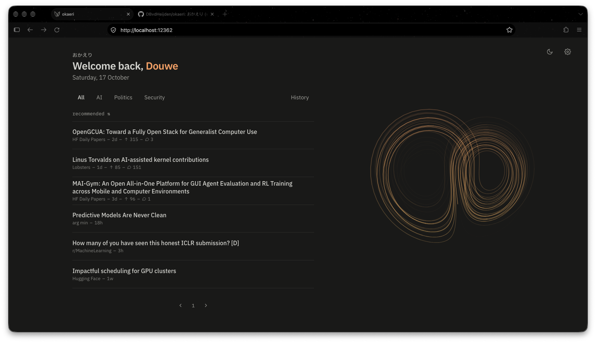
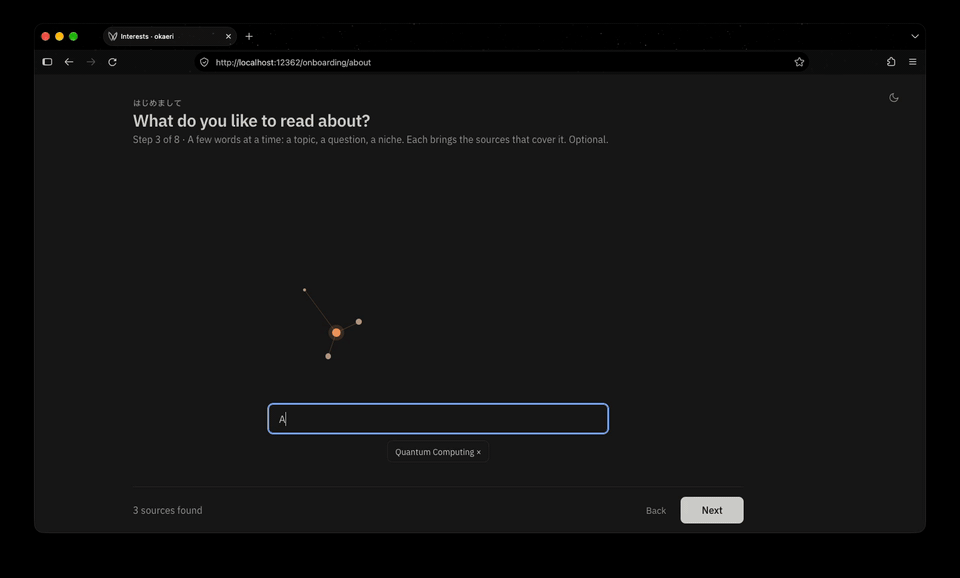

# okaeri

おかえり ("welcome back"): a calm localhost homepage with the latest papers, blogs, forums and news in science and tech.
It fetches the sources you pick in the background and gathers them on one page, in tabs you set up yourself.

Each tab shows stories newest first, or recommended. For the recommended stories a small embedding model on your machine runs in the background.
We register your clicks and hides, and have a simple algorithm for ranking the feed. Your reading history never leaves your device.
Your recommendation algorithm is yours, tune it however you'd like (either from the UI, or delve into the code).



## Requirements

- macOS, Linux or Windows (Windows is new and not properly tested yet: [feedback welcome](https://github.com/DBvdHeijden/okaeri/issues)!)
- ~500 MB disk: the Python environment and a local embedding model
- Internet for the first run (and for fetching feeds, of course)

## Install

Paste this into a terminal (or [read install.sh](install.sh) first):

```sh
curl -fsSL https://raw.githubusercontent.com/DBvdHeijden/okaeri/main/install.sh | sh
```

On Windows, in PowerShell:

```powershell
powershell -ExecutionPolicy ByPass -c "irm https://raw.githubusercontent.com/DBvdHeijden/okaeri/main/install.ps1 | iex"
```

It puts okaeri in `~/okaeri`, or `%USERPROFILE%\okaeri` on Windows (installing [uv](https://docs.astral.sh/uv/) first if you don't have it), and opens http://localhost:12362 in your browser, where you pick your sources. Set it as your browser's homepage.

Prefer git? `git clone https://github.com/DBvdHeijden/okaeri.git && cd okaeri && uv run main.py install`.

The first time, okaeri also downloads a language model (~330 MB) and indexes your articles in the background, which can take a few minutes.

**Good to know:** okaeri keeps running in the background and starts whenever you log in. Whenever new stories come in, it runs a small AI model on your computer to rank them: a separate process that uses up to two CPU cores and about 1.3 GB of memory for a short while, then exits. That can cost some battery on a laptop. Stop it any time with `uv run main.py uninstall`. okaeri comes as is, you run it at your own risk.

## Onboarding

The first time you open okaeri, you are walked through our onboarding sequence. This will take a few minutes, and set your homepage up for you. You say what you like to read about, pick sources, mark some stories you'd read, and arrange your tabs. Your answers give the recommendations a head start, and you can change sources, tabs and ranking later in Settings. Your preferences will be further tuned as you use okaeri.



## Commands

Run these from the okaeri folder (`cd ~/okaeri`).

```sh
uv run main.py update     # get the latest version, sync dependencies, restart
uv run main.py status     # one screen with what's going on; share this when asking for help
uv run main.py logs       # the last 50 lines of data/okaeri.log
uv run main.py restart
uv run main.py uninstall  # removes the background service, leaves your data; delete the folder to remove everything
```

## Your data

Everything lives in the repo folder and is never committed: `data/` holds the database with your reading history, the embedding model and the log; `settings.json` holds your sources and tabs. It stays on your machine.

okaeri only goes online to fetch your feeds, download the embedding model from Hugging Face once, and get the latest version from GitHub when you run `update` (installing also fetches uv and Python packages). No telemetry, no accounts.

## Sources

The [catalog](catalog/sources.json) has about 90 sources in English and Dutch: papers, blogs, news and forums on AI, software, security, science, space, climate, world news, politics and sports. Think arXiv, Nature, Quanta, Hacker News, Simon Willison and Ars Technica.

Pick sources on the Settings page (the gear). Adding your own feeds there is in progress; for now, add one to `catalog/sources.json` and send it as a pull request ([how](CONTRIBUTING.md#common-changes)). You can also list source ids under `sources.enabled` in `settings.json`.

## Recommendations

Stories are embedded locally with [EmbeddingGemma 2](https://huggingface.co/google/embeddinggemma-2) (downloaded on first use into `data/models/`, ~330 MB), licensed under the [Apache License 2.0](https://ai.google.dev/gemma/docs/gemma_4_license). Tabs set to “Recommended” rank by them: stories close to what you opened or liked go up, look-alikes of what you hid go down, and older stories fade. Each topic has its own taste: liking AI stories lifts AI, without sinking politics. [docs/ranking.md](docs/ranking.md) explains the whole score.

## FAQ

**Windows?** Yes, since recently. It runs as a Task Scheduler task that starts when you log in. It seems to work, but hasn't been tested properly yet: if something breaks, please [open an issue](https://github.com/DBvdHeijden/okaeri/issues) with the output of `uv run main.py status`.<br>
**Docker, or access from another device on my network?** Not yet: okaeri listens on `127.0.0.1`, so you can only open it on the computer it runs on. Once I find some time, maybe I'll get to this! <br>
**Sync across devices?** No, each install keeps its own history on its own machine.

## License

okaeri is free software under the [GNU Affero General Public License v3.0](LICENSE) (AGPL-3.0): use it, change it and share it. If you share a changed version, or run one for others as a service, you share its source under the same license.

Contributions are (very!) welcome and are licensed under the same AGPL-3.0. Start with [CONTRIBUTING.md](CONTRIBUTING.md).
