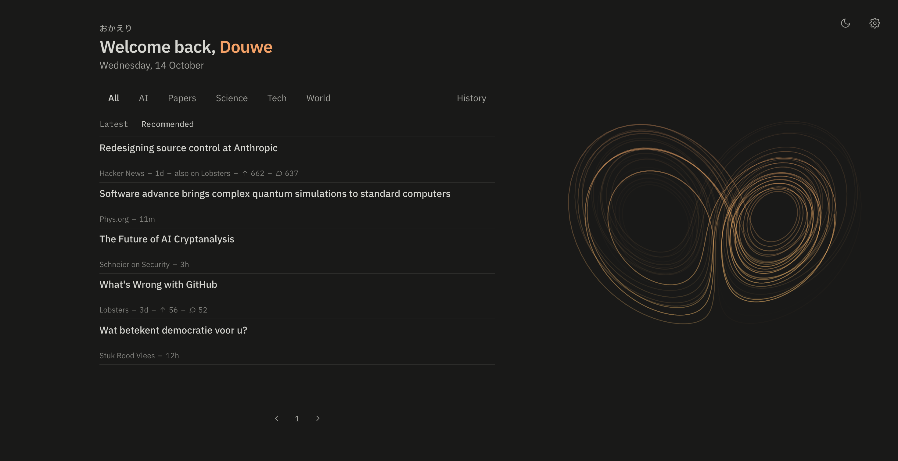

# okaeri

おかえり ("welcome back"): a calm localhost homepage with the latest papers, blogs, forums and news in science and tech.
It fetches the sources you pick in the background and gathers them on one page, in tabs you set up yourself.

Each tab shows stories newest first, or recommended: a small embedding model on your machine learns from what you
open, like and hide, and puts the most relevant stories on top. Your reading history never leaves your device. 
Your recommendation algorithm is yours, tune it however you'd like. 



## Requirements

- macOS or Linux
- ~500 MB disk: the Python environment and a local embedding model
- Internet for the first run (and for fetching feeds, of course)

## Install

Paste this into a terminal:

```sh
curl -fsSL https://raw.githubusercontent.com/DBvdHeijden/okaeri/main/install.sh | sh
```

It puts okaeri in `~/okaeri` (installing [uv](https://docs.astral.sh/uv/) first if you don't have it) and opens http://localhost:12362 in your browser, where you pick your sources. It runs in the background and starts whenever you log in; set it as your browser's homepage.

Prefer git? `git clone https://github.com/DBvdHeijden/okaeri.git && cd okaeri && uv run main.py install`.

The first time, okaeri also downloads a language model (~330 MB) and indexes your articles in the background, which can take a few minutes. The feed works meanwhile; Settings (the gear) shows the progress until it's done.

**Good to know:** okaeri keeps running in the background and starts whenever you log in. Whenever new stories come in, it runs a small AI model on your computer to rank them: a separate process that uses up to two CPU cores and about 1.3 GB of memory for a short while, then exits. That can cost some battery on a laptop. Stop it any time with `uv run main.py uninstall`. okaeri comes as is, without any warranty; you run it at your own risk.

## Update

The commands below run from the okaeri folder (`cd ~/okaeri`).

```sh
uv run main.py update     # get the latest version, sync dependencies, restart
```

## Troubleshooting

```sh
uv run main.py status     # one screen with what's going on; share this when asking for help
uv run main.py logs       # the last 50 lines of data/okaeri.log
uv run main.py restart
```

## Uninstall

```sh
uv run main.py uninstall
```

This removes the background service and leaves your data alone; delete the folder to remove everything.

## Your data

Everything lives in the repo folder and is never committed: `data/` holds the database with your reading history, the embedding model and the log; `settings.json` holds your sources and tabs. It stays on your machine.

## Sources

Pick sources on the Settings page (the gear), or list their ids under `sources.enabled` in `settings.json`; the ids are in `catalog/sources.json`. To add a feed that isn't in the catalog, add an entry there (one medium and up to two topic tags from `catalog/tags.json`) and send it as a pull request: in a git checkout `update` stops while you have local changes, and an install.sh install replaces them.

## Embedding model

New items are embedded locally with [EmbeddingGemma 2](https://huggingface.co/google/embeddinggemma-2) (downloaded on first use into `data/models/`, ~330 MB), licensed under the [Apache License 2.0](https://ai.google.dev/gemma/docs/gemma_4_license). Tabs set to “Recommended” rank by them: stories close to what you opened or liked go up, look-alikes of what you hid go down. Each topic has its own taste: liking AI stories lifts AI, without sinking politics.

## Development

```sh
uv run main.py                     # run in this terminal: http://127.0.0.1:12362
OKAERI_RELOAD=1 uv run main.py     # auto-reload while editing
OKAERI_FETCH=0 uv run main.py      # don't fetch feeds
OKAERI_DB=/tmp/x.db uv run main.py # default: data/okaeri.db
OKAERI_PORT=12363 uv run main.py   # another port; works for the service commands too
uv run pytest
```

On first run you're sent to onboarding: pick fields and media, then sources, then tick a few sample stories you'd read (saved as seed events for ranking), then tune the ranking dials while the top 5 stories change with them, then set up tabs. Nothing is fetched until you pick sources.

Embedding runs in a short-lived child process, `python -m app.embed`, so the server never holds the model in memory: the 270M text model, 8-bit ONNX from [onnx-community/embeddinggemma-2-ONNX](https://huggingface.co/onnx-community/embeddinggemma-2-ONNX), pinned to a revision, vectors cut to 256 dims and stored in SQLite. Try them out:

```sh
uv run scripts/similar.py "protein folding"   # feed items nearest to a search query
uv run scripts/similar.py --item <id>         # nearest to an article; the id is the one in /r/<id>
```

## License

okaeri is free software under the [GNU Affero General Public License v3.0](LICENSE) (AGPL-3.0): use it, change it and share it. If you share a changed version, or run one for others as a service, you share its source under the same license. It comes without any warranty.

Contributions are welcome. By sending a pull request, you agree that your contribution may be used under the AGPL-3.0 and under the MIT License, so the project can keep its licensing options open.
